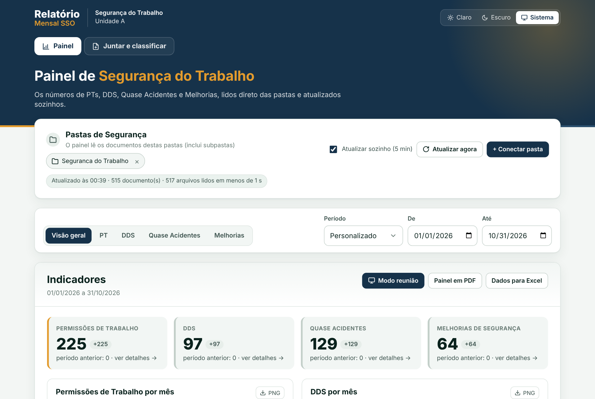
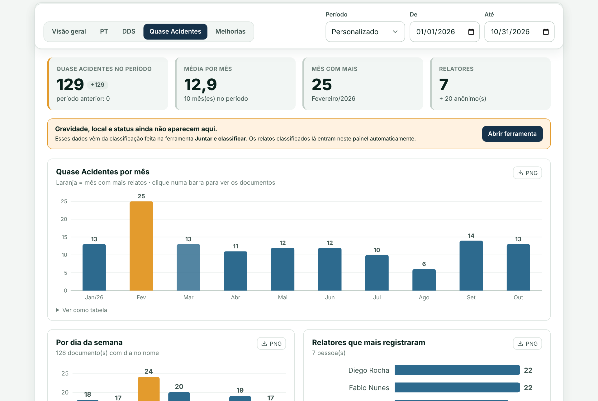
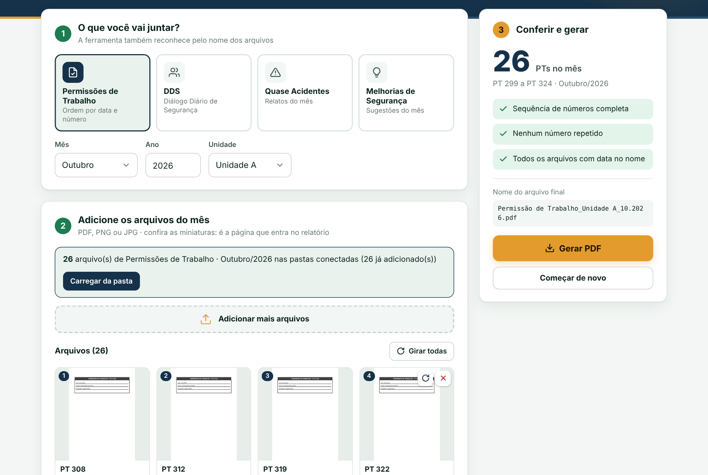

# Relatório Mensal SSO

Ferramenta para a área de **Segurança do Trabalho** que monta os relatórios mensais de Permissões de Trabalho (PT), DDS, Relatos de Quase Acidente e Melhorias de Segurança. Ela também tem um **painel que lê as pastas da rede** e se atualiza sozinho.

É **um único arquivo HTML**: abre com dois cliques, não precisa instalar nada e nenhum documento sai do computador.



> Esta é a versão pública e genérica de uma ferramenta que desenvolvi e uso no trabalho. Os nomes, documentos e números das imagens e dos testes são **fictícios**.

## O problema

Todo mês, alguém da Segurança do Trabalho precisava montar de 5 a 6 relatórios:

1. abrir cada documento escaneado (uma PT tem 4 páginas) e separar só a 1ª folha;
2. juntar tudo num PDF, contar, conferir a sequência de números e lançar no indicador;
3. repetir o processo para DDS, Quase Acidentes e Melhorias;
4. montar os gráficos para a reunião à mão.

Cada relatório levava de 40 min a 1 h. Parte desse tempo era escanear o papel, que continua existindo e hoje é feito em lote, separado do relatório. Por isso, a conta abaixo considera **só a montagem**: cerca de 25 min por relatório.

## O resultado

| | Antes | Com a ferramenta |
|---|---|---|
| Montar um relatório (sem contar o escaneamento) | ~25 min | **~3 min** |
| Tempo por mês (5 a 6 relatórios) | ~2 h 20 | **~17 min** |
| Juntar a 1ª página de 121 PDFs | página por página | **menos de 1 s** |
| Conferência de números repetidos ou faltando | à mão, quando dava | automática (achou uma PT duplicada no 1º uso) |
| Gráficos para a reunião | Excel/PowerPoint | Painel em PDF, PNG por gráfico e CSV |
| Quem consegue fazer | quem conhecia o processo | a técnica de segurança, sozinha |

São cerca de **24 horas por ano** devolvidas para a equipe. É uma estimativa conservadora: o escaneamento não entra na conta, e o tempo "com a ferramenta" ainda será cronometrado.

## O que ela faz

**Painel** (lê as pastas)
- Conecta as pastas da rede uma única vez (File System Access API). A permissão fica guardada no navegador.
- Reconhece o tipo de cada documento pelo nome e pela pasta, e a data pela pasta do mês e pelo dia no nome.
- Ignora relatórios já gerados, modelos em branco, fotos de evidência e planilhas.
- Tem filtros por tipo e período (mês, trimestre, ano ou "de… até…") e compara com o período anterior.
- Mostra gráficos por mês, por dia da semana e por pessoa, além de gravidade, local e status das ações.
- Clicar numa barra lista os documentos daquele mês, com busca, e abre o PDF com um clique.
- Atualiza sozinho a cada 5 minutos e marca os documentos novos.



**Juntar e classificar** (a ferramenta do mês)
- Junta a 1ª página de cada PDF (ou imagem PNG/JPG) do mês num arquivo só, com o nome no padrão da empresa.
- Confere números faltando ou repetidos, dias inválidos, cópias idênticas, arquivos corrompidos, com senha ou com extensão trocada (um PDF salvo como `.png`, por exemplo).
- **Leitura automática dos formulários escaneados (OCR):** descobre se a folha está de lado ou de cabeça para baixo e a endireita. Nos testes com formulários reais, acertou 16 de 16.
- A classificação é rápida: o visualizador abre com zoom na linha da gravidade, e as teclas 1, 2 e 3 marcam Baixa, Média e Alta.



## Por dentro

- **HTML, CSS e JavaScript puro**, num arquivo único que funciona offline. Tema claro, escuro ou do sistema.
- [pdf-lib](https://pdf-lib.js.org/) para montar PDFs e [pdf.js](https://mozilla.github.io/pdf.js/) para as miniaturas.
- [Tesseract.js](https://tesseract.projectnaptha.com/) com o modelo em português, rodando num Web Worker criado a partir do próprio arquivo, sem internet.
- Gráficos em SVG desenhados à mão, com dica ao passar o mouse, tabela acessível e exportação em PNG.
- IndexedDB para guardar as pastas conectadas e a última leitura; localStorage para classificações e histórico.

### Decisões que valem contar
- **Por que um arquivo HTML e não um programa?** O PC da empresa não deixa instalar nada. Um arquivo que abre no navegador passa pelas restrições do TI e qualquer pessoa usa.
- **Por que o OCR não marca a gravidade sozinho?** Testei ler o X do formulário escrito à mão e acertou só 4 a 5 de 15. Um número errado contaminaria o indicador da reunião. Por isso o OCR só endireita a folha e aponta onde olhar, e a pessoa confirma com uma tecla.
- **Privacidade:** os documentos têm nomes de funcionários, então nada é enviado para servidor nenhum. Tudo roda no navegador de quem usa.

## Como rodar

```bash
python scripts/build.py          # baixa as bibliotecas (versões fixas) e gera dist/relatorio-mensal-sso.html
```
Depois é só abrir `dist/relatorio-mensal-sso.html` no Chrome ou no Edge.

## Testes

```bash
pip install -r requirements-dev.txt && playwright install chromium
python tests/gerar_fixtures.py   # cria ~650 PDFs e pastas fictícios
pytest tests -q
```
Os testes abrem a ferramenta num navegador de verdade (Playwright) e cobrem:
- arquivos vazios, corrompidos, com senha, imagem falsa, `Thumbs.db`;
- nome de arquivo com HTML malicioso;
- armazenamento do navegador bloqueado;
- 121 PDFs de uma vez;
- mês curto e ano inválido;
- contagem do painel por tipo, clique na barra, exportações;
- documento novo chegando na pasta.

Na versão de produção, a bateria completa tem 69 testes, incluindo os de OCR com formulários reais, que não vão para este repositório.

---
## Uso de IA

O código foi escrito com apoio de IA (Claude, da Anthropic). Eu defini o problema, testei cada versão com dados fictícios e revisei o resultado. A ferramenta em si **não usa IA**: o OCR (Tesseract) roda no próprio computador e nenhum documento sai dele.

---
Feito por [Arthur Tureck](https://www.linkedin.com/in/arthur-de-conti-tureck-86b317287/).
